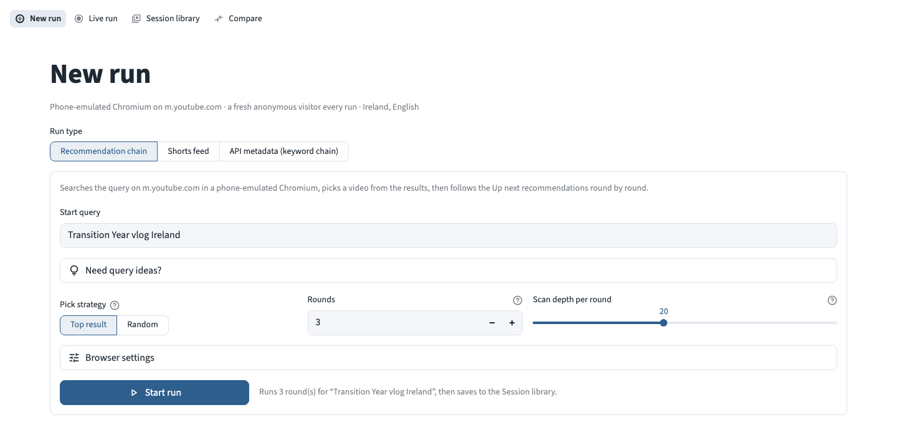

# RecPath

RecPath watches YouTube the way someone on a phone does and records what YouTube recommends. You type a search query; the app opens mobile YouTube (`m.youtube.com`) in a phone-emulated browser, picks a video from the results, then follows the recommendations round by round. You see the phone screen live while it runs, and every round is saved with screenshots, the full list of what was shown, and any ads.

It is a small, controlled research tool: one anonymous, logged-out visitor per run, a few rounds at a time, never liking, commenting, subscribing or tapping ads.



## What you can do

- **Follow a recommendation chain**: search → pick a video → follow its recommendations for N rounds, by top result or at random.
- **Watch the Shorts feed**: swipe through Shorts from a search and record each one, including ad Shorts.
- **See it live**: a mirror of the phone screen, progress, and the chain so far, with a Stop button.
- **Look back at every run** in the Session library: screenshots per round, the path graph, every recommended video, ads, raw data. Continue a chain or branch off from any recommended video.
- **Compare runs**: how much two to four runs overlap.
- **Choose the content location**: YouTube's Location setting (Ireland, UK or US) for a run, checked on every page.
- **Run a planned batch** from the command line: the same queries in several locations, repeated and interleaved.
- **Export** JSON and CSV for analysis.

What gets recorded each round: every card in the feed in order (normal videos, Shorts, ads, live streams, movies, playlists, mixes, channels), titles, channels and durations, which video was picked and why, screenshots on arrival and of the picked card, in-player and companion ads, the ads YouTube scheduled for the video, and how the browser got there.

## Before you start

- macOS, Windows or Linux, with an internet connection.
- Python 3.11, preferably through [conda](https://docs.conda.io/) (Miniconda is enough).
- About 600 MB of disk space for the bundled Chromium browser.
- Optional API keys, only for extra features (see [Optional keys](#3-optional-add-api-keys)). The app works without any key.

## 1. Install

Get the code, either with Git:

```bash
git clone https://github.com/jin-phd/RecPath.git
```

```bash
cd RecPath
```

or by downloading the ZIP from GitHub and opening its folder (the one that contains `app.py`) in a terminal. Then, in that terminal:

```bash
conda create -n RecPath python=3.11
```

```bash
conda activate RecPath
```

```bash
python -m pip install -r requirements.txt
```

Then install the browser the app uses, inside the project folder (`.playwright-browsers/`, ignored by Git):

```bash
PLAYWRIGHT_BROWSERS_PATH="$PWD/.playwright-browsers" python -m playwright install chromium
```

On Windows PowerShell, use `$env:PLAYWRIGHT_BROWSERS_PATH="$PWD\.playwright-browsers"; python -m playwright install chromium` instead.

## 2. Start the app

```bash
conda activate RecPath
```

```bash
streamlit run app.py
```

Your web browser opens `http://localhost:8501`. If that port is busy (often an earlier copy of this app that is still running), Streamlit uses the next free one, for example 8502, and prints the address in the terminal. The app only accepts connections from your own computer. Stop it with `Ctrl+C` in the terminal.

## 3. Optional: add API keys

Nothing here is required for the main feature. Keys unlock:

| Key | What it adds |
| --- | --- |
| `YOUTUBE_API_KEY` | Exact metadata (publish date, view/like/comment counts, tags) for recorded videos, and the API metadata mode. |
| `OPENAI_API_KEY` | "Need query ideas?": five suggested search queries from a description of your interest. |
| `GCP_CREDENTIALS_PATH`, `GCP_PROJECT_ID` | Google Trends terms from the BigQuery public dataset. |

Copy `.streamlit/secrets.example.toml` to `.streamlit/secrets.toml` (this file is ignored by Git), uncomment the keys you have and fill them in, then restart the app. Environment variables with the same names also work.

## 4. Your first run

1. **New run.** Type a start query, for example `Transition Year vlog Ireland`. Keep the run type **Recommendation chain**, set **Rounds** to 3, and press **Start run**.
2. **Live run** opens by itself. At the top are the progress bar and **Stop**; below, on the left, is the phone screen as the browser sees it, and on the right the rounds done, the normal videos, Shorts and ads seen, and the chain so far. A 3-round run takes about a minute. **Stop** ends the run within a few seconds: the video being watched is cut short, its list is still read and saved, and everything recorded is kept.
3. When it finishes, press **Open in library**.
4. **Session library** shows every saved run in a table; your run is selected. Below it:
   - **Timeline**: for each round, the screenshot on arrival, the screenshot with the picked card outlined in red, and the player ad if there was one. **Details and branching** opens the round's details with every card on that page; select a normal video, choose Rounds and Pick strategy, and press **Branch from this video** to start a new chain from there.
   - **Path graph**: the chain as a graph, with any branches.
   - **Candidates**: every recorded card of every round, filterable by type.
   - **Ads**: the ads seen and scheduled per round.
   - **Raw JSON**: the saved file itself.
   - **Continue from the last pick** runs more rounds from where the chain ended. **JSON** / **CSV** download this run.
5. **Compare**: choose two to four runs (Shorts feed runs are not listed), for example the same query run twice, to see which videos and recommendations they share.

Only one run can be active at a time in a running copy of the app, because it drives a real browser on your computer, so keep only one copy of the app running. You can switch pages while it runs and come back to Live run.

## Settings explained

On **New run**:

| Setting | What it does |
| --- | --- |
| Run type | **Recommendation chain** (main mode), **Shorts feed**, or **API metadata (keyword chain)**: an API-only chain that does not see YouTube's recommendations; needs a YouTube API key. |
| Start query | What is typed into YouTube search. **Need query ideas?** can suggest queries (OpenAI, Google Trends). |
| Pick strategy | **Top result**: the first eligible normal video. **Random**: any eligible normal video (the random seed is saved). |
| Rounds | How many steps the chain takes (1–10, default 5). |
| Scan depth per round | How many normal videos to read from each list before picking (5–40, default 20; scrolls further down when needed). |
| Shorts to watch | Shorts feed only: how many Shorts to record (1–50, default 10; ad Shorts count). |
| API results per round | API metadata mode only: search results fetched per round (5–50, default 50). |

Under **Browser settings**:

| Setting | What it does |
| --- | --- |
| Content location | YouTube's Location setting for the run: **Ireland (IE)** (default), **United Kingdom (GB)** or **United States (US)**. It is stored before the run the way YouTube's own Location menu stores it (the `PREF` cookie); the IP address, language and time zone stay your computer's, so this is "an Irish viewer who chose UK", not a viewer in the UK. Every round records the location YouTube applied, and the run ends if it differs. |
| Device profile | **Pixel 7** (default; matches the Chromium engine) or **iPhone 13** (the profile older sessions used). |
| Cookie consent answer | How YouTube's EU cookie dialog is answered: **Accept all** or **Reject all**. This changes personalisation and the ads you get, so keep it the same across runs you want to compare. |
| Open the selected video by | **Tap the card** like a user (default), or open its URL directly. Recommendation chain only. |
| Exclude in later rounds | **Everything displayed** (default): a video already shown can never be picked again. **Only selected videos**: only the chain's own picks are excluded. Recommendation chain only. |
| Watch time per video (s) | How long to stay on each video before reading its recommendations (default 6 s; called **Watch time per Short (s)** in Shorts feed mode). Ads are watched for during this time. |
| Pacing between browser actions (ms) | Slows every browser action down a little (default 250 ms). |
| Also open a visible browser window | Shows the real Chromium window as well as the in-page mirror. |
| Enrich with the YouTube Data API | Adds exact metadata (on by default; shown only when `YOUTUBE_API_KEY` is set). |
| Verify Shorts by their URL | On by default. Asks YouTube whether short videos shown as normal cards are really Shorts. |
| Capture YouTube's own card data | On by default. Records YouTube's page data for channel ids, view counts and Shorts signals. |

The app remembers your settings while this browser tab stays open: switching pages keeps them, but reloading the page or opening a new tab starts from the defaults.

**Continue** and **Branch** reuse the measurement settings of the run they start from (content location, device, cookie answer, how videos are opened, exclusion, scan depth, watch time, Shorts checks); for older sessions that did not record them, the panel shows which values come from the New run page. Pacing, the visible window and API enrichment come from the New run page, and you choose Rounds and Pick strategy next to the button.

## Batch runs from the command line

For a study design, put the conditions in a CSV and let the batch runner work through them; no app needs to be open. Each row is one condition, with the columns `query` and `location` (`IE`, `GB` or `US`) and, optionally, `repeats` (default 1), `rounds`, `strategy` (`top_1` or `random`), `consent` (`accept_all` or `reject_all`), `exclude_policy` (`displayed` or `watched`, see Exclude in later rounds), `location_cookie` (`false` keeps the location in the search URL only), `category` (a free label) and `label`:

```csv
query,location,repeats
Online Safety Act,IE,3
Online Safety Act,GB,3
Online Safety Act,US,3
```

Check the plan, then run it:

```bash
python -m recpath.batch design.csv --rounds 3 --dry-run
```

```bash
python -m recpath.batch design.csv --rounds 3
```

Runs are interleaved: repeat 1 of every row in order, then repeat 2, and so on, so the same query in IE, GB and US runs minutes apart. `--pause` sets the wait between runs (10 s by default) and `--batch-id` names the batch. Every run is saved like a run from the app, tagged with its batch, so it shows up in the Session library and Compare. `data/batches/<batch id>.json` lists the runs and how each ended. The batch drives a real browser too, so do not start a run in the app while a batch is running. `Ctrl+C` stops the batch and keeps what was recorded.

## Where your data goes

- `data/sessions/<session_id>.json`: the full record of a run (the canonical file), and a `.csv` with one row per card seen in the feeds (one row per Short for Shorts feed runs).
- `data/screenshots/`: the JPEG screenshots.
- `data/batches/`: one file per command-line batch, listing its runs.

These folders are ignored by Git. Runs are saved after every round, so an interrupted run keeps what it recorded. To keep data somewhere else, set `RECPATH_DATA_DIR` before starting the app. When opening a CSV in Excel or Google Sheets, import it as text: titles come from YouTube unchanged.

## Troubleshooting

| Problem | What to do |
| --- | --- |
| "Playwright could not launch Chromium" | Run the browser install command from step 1 again, from the project folder. |
| The page says Playwright is not installed | `conda activate RecPath`, then `python -m pip install -r requirements.txt`, then run the browser install command from step 1 again. |
| The app opened on 8502 (or another port) instead of 8501 | Something else is using 8501, often an earlier copy of this app. Close that terminal (run only one copy, or two runs could drive two browsers at once), or choose a port yourself: `streamlit run app.py --server.port 8502`. |
| A run ends with "Could not reach YouTube (ERR_...)" | The browser could not connect to YouTube, so the problem is the computer's network, not the run settings. The first page is already tried twice. Check the VPN, proxy or firewall (university and company networks often interfere), or try another network such as a phone hotspot, then start the run again. |
| A run stops with "Could not answer the YouTube cookie dialog" | YouTube showed a dialog the requested answer did not fit. Try again, or try the other consent answer; the session's Raw JSON shows what was clicked. |
| A run ends because "YouTube did not apply the requested content location" | YouTube used another location than the one chosen, for example when **Content location** was set without the cookie in a batch (`location_cookie` false). The round details and the error message show the requested and the applied location. |
| "No recommendation list was found on the page" | YouTube may have changed its page layout. Try again later; if it keeps happening, the extractor in `recpath/js/feed_cards.js` needs an update. |
| Start run is greyed out | The reason is shown next to the button: the start query is empty, another run is still active (see Live run), **API metadata (keyword chain)** is selected without a `YOUTUBE_API_KEY`, or Playwright is not installed. |
| A key "is empty in secrets.toml" | Remove that line from `.streamlit/secrets.toml` or fill it in; an empty entry also hides an environment variable of the same name. |
| No ads appear | Ads are not shown on every video. With **Reject all** you get non-personalised ads only. |

## Responsible use

The browser is an emulated phone, not a real device, and every run is a fresh anonymous visitor. YouTube's Terms of Service restrict automated access, so keep runs small and documented, preferably under your institution's research-ethics approval. For data at scale, consider official researcher access (the YouTube Researcher Program, or DSA Article 40 data access in the EU).

## More

- [docs/REFERENCE.md](docs/REFERENCE.md): how a run works, ads and Shorts detection, safeguards, the data model, CSV columns, configuration and the code map.
- Run the tests: `python -m unittest discover -s tests` (includes offline browser tests that need the installed Chromium).

## License

[MIT](LICENSE)
